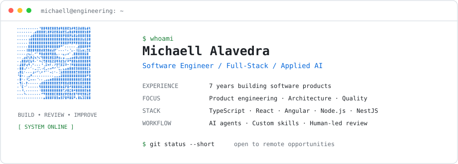

  <picture>
    <source media="(prefers-color-scheme: dark)" srcset="./assets/profile-dark.svg" />
    <source media="(prefers-color-scheme: light)" srcset="./assets/profile-light.svg" />
    
  </picture>

  <a href="https://www.michaellalavedra.com">Portfolio</a>
  &nbsp;·&nbsp;
  <a href="https://github.com/gitchaell">GitHub</a>
  &nbsp;·&nbsp;
  <a href="https://github.com/gitchaell?tab=repositories">Projects</a>

  
<strong>Engineering experience</strong>

  **Software Engineering · 7 years**

  - Full-stack product development across frontend, backend, APIs, and cloud deployments.
  - Architecture, domain-driven design, application security, and automated testing.
  - AI-assisted engineering with coordinated agents, custom skills, and human-led review.

  
<strong>Core technologies</strong>

  TypeScript · JavaScript · React · Angular · Node.js · NestJS · PostgreSQL · Firebase · AWS · GCP · Docker · Vitest · Playwright

  
<strong>Selected projects</strong>

  - [DevTrack](https://devtrack.michaellalavedra.com) — developer-habits tracker.
  - [PlayTS](https://playts.michaellalavedra.com) — TypeScript playground and editor.
  - [Exavatar](https://exavatar.michaellalavedra.com) — avatar generation API.
  - [Angular VS Code Theme](https://marketplace.visualstudio.com/items?itemName=MichaellAlavedraMunayco.angular-theme) — editor theme for Angular developers.
  - [Irdin](https://irdin.michaellalavedra.com) — language and writing-system project.

  Building thoughtfully. Reviewing carefully. Improving continuously.

